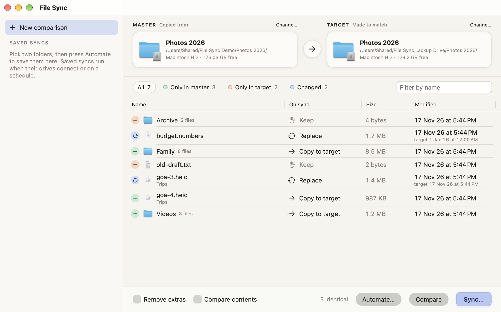

# File Sync

A small Mac app that keeps two drives in step. Pick a **master** and a **target** (any folder, on an internal or external drive), see what's different, and make the target match the master after you review it.



## What it does

- **Compare**: lists what is only in the master, only in the target, or changed. It compares by size and modification date (with 2 seconds of slack for exFAT/FAT drives), and can also compare file contents. A folder that exists on one side only is a single row.
- **Pick any drive or folder**: a built-in picker lists the drives that are plugged in and your usual places, with a clear "Use" button. You can also drop a folder in from Finder.
- **Review first**: Sync opens a preview of what will be copied, replaced and moved to the Trash. Nothing changes until you confirm.
- **Safe by default**: files that exist only in the target are kept unless you turn on *Remove extras*. Even then they go to the Trash and are never deleted for good. A replacement is written to a temporary copy and then swapped in.
- **Saved syncs**: save a pair to run when both drives are connected, every few hours, daily or weekly. Choose *Ask me first* (notify and wait for review) or *Sync automatically*. File Sync keeps running in the menu bar when the window is closed.

## Requirements

- macOS 15 or later
- Xcode 16 or later and [XcodeGen](https://github.com/yonaskolb/XcodeGen)

## Build

```bash
xcodegen
xcodebuild -scheme FileSync -destination 'platform=macOS' build
xcodebuild -scheme FileSync -destination 'platform=macOS' test
```

To sign with your own team, set `DEVELOPMENT_TEAM` in `project.yml` (or in Xcode) before building.

The app isn't sandboxed, so that it can read any drive you pick from its own list. macOS asks before it opens files on removable volumes.

## Layout

| Path | What it is |
|---|---|
| `FileSync/Engine/` | Comparer, Planner, Syncer, schedule math and the saved-sync store |
| `FileSync/Views/` | SwiftUI screens: location cards, picker, difference list, review and Automate sheets |
| `FileSync/Scheduler.swift` | Runs saved syncs when drives connect or a schedule is due |
| `FileSyncTests/` | Engine and scheduler tests (Swift Testing) |
| `Design/make_icon.swift` | Draws the app icon |
